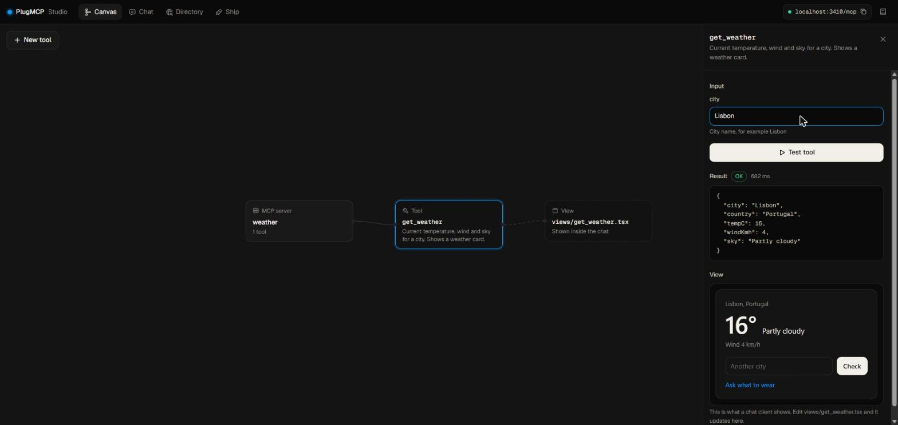

# PlugMCP SDK

**Build MCP servers and MCP Apps in one file. See your tools on a canvas, chat with them using your own key, and ship.**

[](https://www.npmjs.com/package/plugmcp)
[](LICENSE)
[](https://plugmcp.ai/mcp)

The PlugMCP SDK is an open-source TypeScript framework for the [Model Context Protocol](https://modelcontextprotocol.io). You write tools with Zod, add a React file to give a tool a UI that renders inside Claude, ChatGPT and other chat clients ([MCP Apps](https://modelcontextprotocol.io/extensions/apps)), and test everything in a local Studio. No account. No telemetry.

```bash
npx create-plugmcp my-server
cd my-server
npm run dev
```



## Why this one

- **One file per server, one file per view.** No decorators, no second project, no registration step. A file at `views/get_weather.tsx` is the UI for the tool named `get_weather`.
- **A Studio that runs on your machine.** A map of your tools, a form to test each one, and the tool's view rendered the way a chat client shows it.
- **Chat with your own key.** OpenAI, Anthropic, Google, OpenRouter, Ollama or any OpenAI-compatible endpoint. The key stays in a local file and goes only to the provider you chose. It never reaches the browser or us.
- **A directory built in.** Search 70,000+ existing servers before you build a duplicate, and add hosted ones to your chat to try them next to your own.
- **Works with the Claude Agent SDK.** The same tools run in-process inside an agent with one line.
- **Fast.** One process. The starter is ready in about 0.2 seconds, and edits reload without a restart.

## A server

```ts
// server.ts
import { createServer } from "plugmcp";
import { z } from "zod";

const server = createServer({ name: "weather" });

server.tool(
  {
    name: "get_weather",
    description: "Current weather for a city. Shows a weather card.",
    input: z.object({ city: z.string().describe("City name") }),
  },
  async ({ city }) => {
    const data = await lookUp(city);
    return { city, tempC: data.temp, sky: data.sky }; // a plain object is enough
  },
);

export default server;
```

The handler's input is typed from the schema. Return a string, a plain object, or a full MCP result. A thrown `Error` becomes an error result the model can read.

## A view (an MCP App)

```tsx
// views/get_weather.tsx
import { useTool } from "plugmcp/view";

export default function WeatherCard() {
  const { output, isPending, callTool, sendMessage, theme } = useTool<{ city: string; tempC: number; sky: string }>();
  if (isPending) return <p>Checking the weather</p>;
  return (
    <div>
      <h2>{output?.tempC}° in {output?.city}</h2>
      <button onClick={() => sendMessage(`What should I wear in ${output?.city}?`)}>Ask what to wear</button>
    </div>
  );
}
```

That is the whole integration. The SDK bundles the view into one self-contained HTML file, serves it as a `ui://` resource with the `text/html;profile=mcp-app` type, and links it to the tool, following the [MCP Apps specification](https://github.com/modelcontextprotocol/ext-apps), the open standard that Claude, ChatGPT, VS Code and other clients implement.

`useTool` gives you:

| | |
|---|---|
| `input`, `output`, `text` | The arguments the model sent and what your handler returned |
| `isPending`, `isError` | Where the call is |
| `callTool(name, args)` | Call any tool on your server from the view |
| `sendMessage(text)` | Put a message into the conversation |
| `openLink(url)` | Ask the host to open a link |
| `theme` | `light` or `dark`, from the host |

## The Studio

`npm run dev` opens it at `http://localhost:3333`.


| Tab | What it does |
|---|---|
| **Canvas** | Your server, each tool, and each view. Select a tool to fill in its input, run it, and see the result and the view. **New tool** writes a starting point into your project. |
| **Chat** | A conversation with your server. Tool calls and views appear inline, as they would in a chat client. |
| **Directory** | Search [plugmcp.ai](https://plugmcp.ai/mcp). Add any hosted server to your chat. |
| **Ship** | Install buttons for Cursor and VS Code, commands for Claude Code and Codex, and the steps to go live. |

Keys for the chat are read from your project's `.env` (`OPENAI_API_KEY`, `ANTHROPIC_API_KEY`, `GOOGLE_GENERATIVE_AI_API_KEY`, `OPENROUTER_API_KEY`) or saved from the Chat tab to `~/.plugmcp/keys.json`.

## Use the tools in the Claude Agent SDK

```ts
import { query } from "@anthropic-ai/claude-agent-sdk";
import { toAgentSdk } from "plugmcp/agent";
import server from "./server.js";

const { mcpServers, allowedTools } = toAgentSdk(server);

for await (const message of query({ prompt: "What is the weather in Lisbon?", options: { mcpServers, allowedTools } })) {
  // ...
}
```

No server to start and no network hop. Scaffold a working example with `npx create-plugmcp my-agent --template agent`.

## Command line

| Command | |
|---|---|
| `plugmcp dev` | Run the server and the Studio. Reloads on save. |
| `plugmcp build` | Bundle the server and its views into `dist/`. |
| `plugmcp start` | Serve the build over Streamable HTTP at `/mcp`. Add `--stdio` for stdio. Reads `PORT`. |
| `plugmcp search <words>` | Search the PlugMCP directory. |
| `plugmcp add <slug>` | Add a directory server to this project's Studio chat. |
| `plugmcp list` | Give your server a page in the directory. |
| `plugmcp login` | Save a plugmcp.ai account key on this machine. |
| `plugmcp deploy --url <url>` | Put a server you already host behind plugmcp.ai. |

`list` and `deploy` take `--dry-run` to print what would be sent without sending it.

## Going live

The SDK does not need PlugMCP's cloud. `plugmcp build` produces a plain Node server you can run on Railway, Fly, a container, or your own machine.

```bash
plugmcp build
plugmcp start
```

When it has a public address, [plugmcp.ai](https://plugmcp.ai) adds what a production server needs:

- **A directory page** with install buttons for every client, so people and agents can find it: `plugmcp list --url https://your-host.example/mcp`
- **A gateway address, API keys you can revoke, a log of every call, and alerts** when it breaks: `plugmcp deploy --url https://your-host.example/mcp`

Every server also answers a browser at its own `/mcp` address with a page listing its tools and how to connect.

## Templates

| Template | |
|---|---|
| `starter` (default) | A weather tool with a view. Real data, no key needed. |
| `blank` | One tool, nothing else. |
| `agent` | The starter, plus a script that runs the tools in the Claude Agent SDK. |

```bash
npx create-plugmcp my-server --template blank
```

## How it compares

Other good frameworks exist, and you should pick the one that fits.

- [mcp-use](https://github.com/mcp-use/mcp-use) is a larger framework with an agent client, an inspector and its own cloud.
- [NitroStack](https://github.com/nitrocloudofficial/nitrostack) is a NestJS-style framework with modules, decorators and a desktop studio.
- The official [MCP TypeScript SDK](https://github.com/modelcontextprotocol/typescript-sdk) and [ext-apps](https://github.com/modelcontextprotocol/ext-apps) are what this SDK is built on. Use them directly when you want full control.

PlugMCP SDK aims to be the smallest path from an idea to a tool with a UI that you can see, test and talk to, with a public directory attached.

## Requirements

Node 20.19 or newer. Views use React 18 or 19.

## Packages

| Package | |
|---|---|
| [`plugmcp`](packages/plugmcp) | The SDK, the command line and the Studio. |
| [`create-plugmcp`](packages/create-plugmcp) | The project scaffolder. |

## Contributing

Issues and pull requests are welcome. See [CONTRIBUTING.md](CONTRIBUTING.md). To report a security problem, see [SECURITY.md](SECURITY.md).

## License

[MIT](LICENSE)
