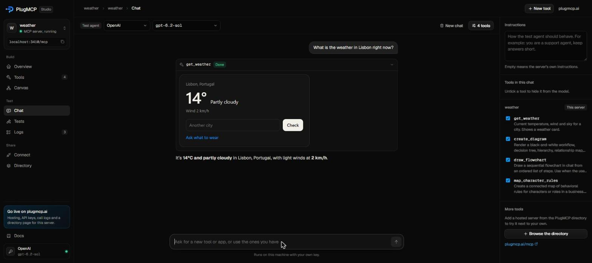
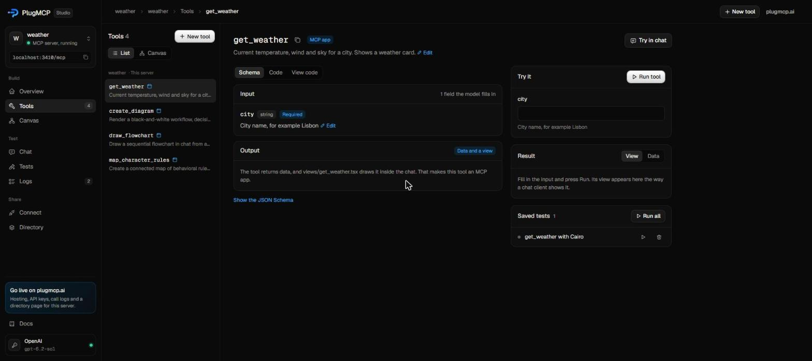

# PlugMCP: the framework for building MCP servers and MCP apps

**Build, test and ship MCP servers and MCP apps in TypeScript. Write a tool or ask the built-in chat to write it, see every server and tool on a canvas, edit schemas in place, save tests, and chat with your own model key. Open source, local, no account.**

[](https://www.npmjs.com/package/plugmcp)
[](LICENSE)
[](https://plugmcp.ai/mcp)

[Website](https://plugmcp.ai) · [MCP directory](https://plugmcp.ai/mcp) · [Host a server](https://plugmcp.ai/app) · [How it is built](docs/ARCHITECTURE.md)

PlugMCP is an open-source TypeScript framework for the [Model Context Protocol](https://modelcontextprotocol.io) (MCP), made by the team behind [plugmcp.ai](https://plugmcp.ai), the directory of 95,000+ MCP servers.

- An **MCP server** is a named set of tools behind one address. Any MCP client can use it: Claude, ChatGPT, Cursor, VS Code, your own agent.
- A **tool** is one function a model can call. You write it with [Zod](https://zod.dev) and a handler.
- An **MCP app** is a tool with a view: a React file that draws the tool's result inside the chat ([MCP Apps](https://modelcontextprotocol.io/extensions/apps)). Servers and apps are built the same way; an app just adds one file.

```bash
npx create-plugmcp my-server
cd my-server
npm run dev
```



## How it works

1. **Create a project.** `npx create-plugmcp my-server` gives you one MCP server with a working tool and a view.
2. **Open the Studio.** `npm run dev` runs your servers and opens the Studio at `http://localhost:3333`.
3. **Add your model key.** Open **Chat**, pick a provider (OpenAI, Anthropic, Google, OpenRouter, Ollama or any OpenAI-compatible endpoint) and paste your key. It is saved on your machine and sent only to that provider.
4. **Build.** Ask the chat for a tool or an MCP app and it writes the code into your project and runs it. Or press **New tool**, or write `server.tool(...)` yourself.
5. **See it and change it.** The **Canvas** draws the MCP server with its tools under it. Click the server to edit its name and description. Click a tool for its schema, with an Edit link on every description, a form to run it, and its code.
6. **Test it.** Run a tool with real input and press **Save as test**. The **Tests** page runs every saved test, and `plugmcp test` does the same in a terminal or in CI.
7. **Connect and ship.** **Connect** gives install buttons for Cursor, VS Code, Claude Code and Codex. `plugmcp build` makes a plain Node server you can host anywhere, and [plugmcp.ai](https://plugmcp.ai) lists and hosts it.


## Why PlugMCP

- **One file per server, one file per view.** No decorators, no second project, no registration step. A file at `views/get_weather.tsx` is the UI for the tool named `get_weather`.
- **Several MCP servers in one project.** Start another from the Studio. Each has its own tools, its own canvas and its own address.
- **A chat that builds.** Say what you want. Your own model writes the tool and its view into your project, runs it and shows the result. Code that does not load is never kept.
- **A canvas for every server.** The server on top, its tools under it, each with its description and inputs. Drag the cards where you want them.
- **Schema first, editable in place.** Every tool opens on what a model sees: each input, its type, whether it is required and what it means. Change any description, or the server's own name and description, without opening the code. A form to run the tool sits beside it.
- **Tests you keep.** Save any run as a test, say what the result must contain, and run them all after every change, in the Studio or with `plugmcp test` in CI.
- **Your own key, kept local.** The key stays in a local file and goes only to the provider you chose. It never reaches the browser or us. No telemetry.
- **A directory built in.** Try popular servers from [plugmcp.ai](https://plugmcp.ai/mcp) next to your own, and search 95,000+ before you build a duplicate.
- **Works in agents.** The same tools run in-process in the Claude Agent SDK with one line, and over HTTP or stdio in anything else.
- **Fast.** One process. The starter is ready in about 0.2 seconds, and edits reload without a restart.

## A server

```ts
// server.ts
import { createServer } from "plugmcp";
import { z } from "zod";

const server = createServer({ name: "weather" });

server.tool(
  {
    name: "get_weather",
    description: "Current weather for a city. Shows a weather card.",
    input: z.object({ city: z.string().describe("City name") }),
  },
  async ({ city }) => {
    const data = await lookUp(city);
    return { city, tempC: data.temp, sky: data.sky }; // a plain object is enough
  },
);

export default server;
```

The handler's input is typed from the schema. Return a string, a plain object, or a full MCP result. A thrown `Error` becomes an error result the model can read.

## A view (an MCP App)

```tsx
// views/get_weather.tsx
import { useTool } from "plugmcp/view";

export default function WeatherCard() {
  const { output, isPending, callTool, sendMessage, theme } = useTool<{ city: string; tempC: number; sky: string }>();
  if (isPending) return <p>Checking the weather</p>;
  return (
    <div>
      <h2>{output?.tempC}° in {output?.city}</h2>
      <button onClick={() => sendMessage(`What should I wear in ${output?.city}?`)}>Ask what to wear</button>
    </div>
  );
}
```

That is the whole integration. The SDK bundles the view into one self-contained HTML file, serves it as a `ui://` resource with the `text/html;profile=mcp-app` type, and links it to the tool, following the [MCP Apps specification](https://github.com/modelcontextprotocol/ext-apps), the open standard that Claude, ChatGPT, VS Code and other clients implement.

`useTool` gives you:

| | |
|---|---|
| `input`, `output`, `text` | The arguments the model sent and what your handler returned |
| `isPending`, `isError` | Where the call is |
| `callTool(name, args)` | Call any tool on your server from the view |
| `sendMessage(text)` | Put a message into the conversation |
| `openLink(url)` | Ask the host to open a link |
| `theme` | `light` or `dark`, from the host |

## The Studio

`npm run dev` opens it at `http://localhost:3333`.



| Page | What it does |
|---|---|
| **Overview** | Every MCP server in the folder as a card, with **New MCP server** to start another. Below it, the open server at a glance: tools, views, calls and what to do next. |
| **Tools** | Every tool, schema first: each input with its type and description, each with an Edit link. A form beside it runs the tool and shows the result and the view. Save a run as a test. Edit the tool code and the view code in place. **New tool** writes one from a description, or adds a blank one. |
| **Chat** | One test agent for the open server, on your own model key. Ask for a tool or an MCP app and it is written into your project and run in the chat. Tool calls and views appear inline, as they would in a chat client. Set its instructions, switch models, turn tools on and off. |
| **Canvas** | One canvas for each MCP server: the server on top, its tools under it, every tool with its description and inputs. Drag cards where you want them. Click the server to edit its name and description. Click a tool to edit its schema, run it and change its code beside the canvas. |
| **Tests** | Every saved test of the server, grouped by tool, with one button to run them all and the reason for each failure. |
| **Logs** | Every tool call the dev server handled, from the Studio, your editor or any other client, with input, result and time. The last 300 are kept across restarts. |
| **Connect** | Install buttons for Cursor and VS Code, commands for Claude Code and Codex, and the steps to go live. |
| **Directory** | Popular servers from [plugmcp.ai](https://plugmcp.ai/mcp) and a search. Add a hosted one to your chat, or open the full directory on plugmcp.ai. |

### More than one MCP server

A folder can hold several MCP servers. The one in `server.ts` answers at `/mcp`. Each folder in `servers/` is another one, with its own `server.ts` and `views/`, and answers at `/mcp/<name>`. **New MCP server** in the Studio creates one; the switcher at the top of the sidebar chooses which one the Studio works on. Build one on its own with `plugmcp build --root servers/<name>`.

Keys are read from your project's `.env` (`OPENAI_API_KEY`, `ANTHROPIC_API_KEY`, `GOOGLE_GENERATIVE_AI_API_KEY`, `OPENROUTER_API_KEY`) or saved from the Studio to `~/.plugmcp/keys.json`.

## Use the tools in the Claude Agent SDK

```ts
import { query } from "@anthropic-ai/claude-agent-sdk";
import { toAgentSdk } from "plugmcp/agent";
import server from "./server.js";

const { mcpServers, allowedTools } = toAgentSdk(server);

for await (const message of query({ prompt: "What is the weather in Lisbon?", options: { mcpServers, allowedTools } })) {
  // ...
}
```

No server to start and no network hop. Scaffold a working example with `npx create-plugmcp my-agent --template agent`, and run it.

## Command line

| Command | |
|---|---|
| `plugmcp dev` | Run every MCP server in the folder and the Studio. Reloads on save. |
| `plugmcp build` | Bundle the server and its views into `dist/`. |
| `plugmcp start` | Serve the build over Streamable HTTP at `/mcp`. Add `--stdio` for stdio. Reads `PORT`. |
| `plugmcp test` | Run the tests saved in the Studio against your code. Exits with 1 when one fails, so it fits CI. |
| `plugmcp search <words>` | Search the PlugMCP directory. |
| `plugmcp add <slug>` | Add a directory server to this project's Studio chat. |
| `plugmcp list` | Give your server a page in the directory. |
| `plugmcp login` | Save a plugmcp.ai account key on this machine. |
| `plugmcp deploy --url <url>` | Put a server you already host behind plugmcp.ai. |

`list` and `deploy` take `--dry-run` to print what would be sent without sending it.

## Going live

The SDK does not need PlugMCP's cloud. `plugmcp build` produces a plain Node server you can run on Railway, Fly, a container, or your own machine.

```bash
plugmcp build
plugmcp start
```

When it has a public address, [plugmcp.ai](https://plugmcp.ai) adds what a production server needs:

- **A directory page** with install buttons for every client, so people and agents can find it: `plugmcp list --url https://your-host.example/mcp`
- **A gateway address, API keys you can revoke, a log of every call, and alerts** when it breaks: `plugmcp deploy --url https://your-host.example/mcp`
- **Toolkits**: one link that combines several servers, so an agent installs them all at once.
- **No code at all**, if you prefer: plugmcp.ai also builds and hosts MCP servers from a form and a visual canvas. See [plugmcp.ai](https://plugmcp.ai).

Every server also answers a browser at its own `/mcp` address with a page listing its tools and how to connect.

## Templates

| Template | |
|---|---|
| `starter` (default) | A weather tool with a view. Real data, no key needed. |
| `blank` | One tool, nothing else. |
| `agent` | The starter, plus a script that runs the tools in the Claude Agent SDK. |

```bash
npx create-plugmcp my-server --template blank
```

## How it compares

Other good frameworks exist, and you should pick the one that fits.

- [mcp-use](https://github.com/mcp-use/mcp-use) is a larger framework with an agent client, an inspector and its own cloud.
- [NitroStack](https://github.com/nitrocloudofficial/nitrostack) is a NestJS-style framework with modules, decorators and a desktop studio.
- The official [MCP TypeScript SDK](https://github.com/modelcontextprotocol/typescript-sdk) and [ext-apps](https://github.com/modelcontextprotocol/ext-apps) are what this SDK is built on. Use them directly when you want full control.

PlugMCP aims to be the smallest path from an idea to an MCP server or MCP app that you can see, test and talk to on your own machine, with a public directory attached.

## Questions

**What is an MCP server?** A program that gives an AI model tools to call, over the [Model Context Protocol](https://modelcontextprotocol.io). Claude, ChatGPT, Cursor, VS Code and most agent frameworks can connect to one.

**What is an MCP app?** A tool that also returns a small interactive page, shown inside the chat. In PlugMCP it is a tool plus one React file in `views/`.

**How do I test an MCP server locally?** `npm run dev` opens the Studio. Run any tool with a form, chat with the server using your own model key, save runs as tests, and run them with `plugmcp test`.

**Does it work with Claude, ChatGPT and Cursor?** Yes. The server speaks standard MCP over Streamable HTTP and stdio, and views follow the MCP Apps standard. The **Connect** page has the install steps for each client.

**Do I need an account or a PlugMCP key?** No. Everything runs on your machine. A model key is only needed for the chat, and it is your own.

**Where can I find existing MCP servers?** The [PlugMCP directory](https://plugmcp.ai/mcp) lists 95,000+, searchable from the Studio and with `plugmcp search`.

## Requirements

Node 20.19 or newer. Views use React 18 or 19.

## Packages

| Package | |
|---|---|
| [`plugmcp`](packages/plugmcp) | The SDK, the command line and the Studio. |
| [`create-plugmcp`](packages/create-plugmcp) | The project scaffolder. |

## Contributing

Issues and pull requests are welcome. See [CONTRIBUTING.md](CONTRIBUTING.md). To report a security problem, see [SECURITY.md](SECURITY.md).

## License

[MIT](LICENSE)
